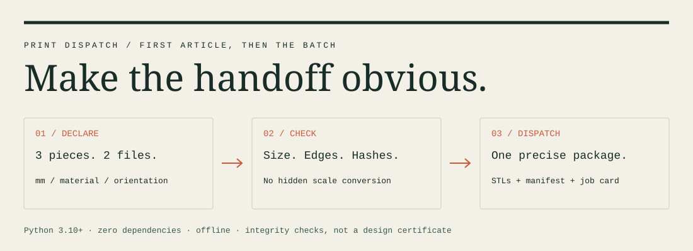

# Print Dispatch

**The right parts. The right quantities. One clear handoff.**

A tiny, dependency-free Python tool for preparing an STL print order before it
leaves your team. Declare millimetres, materials, quantities and the printer's
envelope; get a measured checklist, a printable job card and a reproducible ZIP
containing only the files you meant to send.



[Live example job card](https://muhammadismail0331.github.io/print-dispatch/)
· [Example manifest](examples/job.json) · [Measured example report](examples/report.json)

## Why this exists

On a student sumobot build, preparing the print order became its own problem:
multiple rim revisions, unclear quantities, a 33 mm part inside a 36 mm mould,
and files being forwarded without an explicit scale or test-first instruction.
Print Dispatch makes those handoff decisions visible. It is not a slicer or a
mechanical design approval.

## Run it

Python **3.10+**. No pip install, CAD software, network connection or third-party
dependencies are needed to use the checker. Download/clone this repository, then:

```sh
python print_dispatch.py check examples/job.json
python print_dispatch.py check examples/job.json --report job-report.json --html job-card.html
python print_dispatch.py pack examples/job.json -o first-print.zip
python -m unittest discover -s tests -v
```

Output files are never silently overwritten. Use a new filename when rerunning.
Exit codes: **0** digital checks passed, **1** measured handoff problems, **2**
invalid input or I/O failure. A rejected job is not packaged.

## Describe a job

Put the manifest beside its STL files. Paths are relative to that folder.

```json
{
  "title": "Motor mount — one fit sample",
  "units": "mm",
  "printer_mm": [220, 220, 250],
  "parts": [
    {
      "file": "mount.stl",
      "quantity": 1,
      "material": "PETG",
      "notes": "Bore upright. Test one motor before approving five more."
    }
  ]
}
```

The example above describes a job; it does not supply or certify a motor mount.
The included example STLs are original calibration cuboids generated by
[`examples/make_example.py`](examples/make_example.py), not team CAD or hardware.

## What is checked

| Check | Result |
|---|---|
| Explicit units | Requires `mm`; never guesses or rescales |
| Print quantities | Positive integers, one entry per STL |
| Supplied orientation | Measured XYZ extents against the declared printer envelope |
| Binary STL integrity | Header/triangle length, finite coordinates and degenerate triangles |
| Edge closure and winding | Edge incidence and opposite traversal, joining vertices at 1e-6 declared mm |
| Volume and provenance | Signed volume and SHA-256 of the exact source file |
| Contained source files | Rejects absolute paths, parent traversal, escaped symlinks and duplicate inputs |
| Portable package | Only referenced STLs, rewritten manifest, JSON/HTML card and hashes |

The generated HTML card is self-contained, escapes sender text and works offline.
The ZIP has stable file order and timestamps, so identical inputs produce
identical bytes with the same Python/zlib versions. Its included `job.json` can
be checked again after extraction.

## Limits that matter

- **Binary STL only**, 1–200,000 triangles per file and 1–100 parts per job.
  Export binary STL from your CAD/slicer if the input is ASCII. The limits keep
  this first release lightweight; it does not stream an unlimited edge graph.
- STL has **no intrinsic units**. `mm` is the sender's declaration, not something
  the checker can prove. Confirm a known reference dimension in the slicer.
- The printer check uses the **supplied orientation and axis-aligned extents**.
  It does not rotate, nest parts, reserve a brim margin or guarantee adhesion.
- Closed edges and positive signed volume do **not** prove absence of
  self-intersections, overlapping shells or defects smaller than the vertex
  comparison precision. File normals are ignored; face winding is checked.
- No wall-thickness, support, tolerance, thermal, load, electrical or material
  suitability analysis is performed. The material is a label, not a recommendation.
- Package only approved public data when sharing publicly. The tool sends nothing
  online, and it does not copy your whole working folder.

Always review the slicer preview and print a first article where fit matters.

## Development

The standard-library tests cover translated geometry, quantities, units, broken
meshes, winding, malformed data, unsafe paths, HTML escaping, bed limits, output
preservation and an extracted/rechecked reproducible package. CI runs the same
checks on Windows and Linux. See [CONTRIBUTING](CONTRIBUTING.md) for useful reports.

This project was developed with Codex assistance from a real workshop handoff
need. The example geometry and code are newly authored; no private team chat,
browser data or third-party CAD is included. [MIT license](LICENSE).
